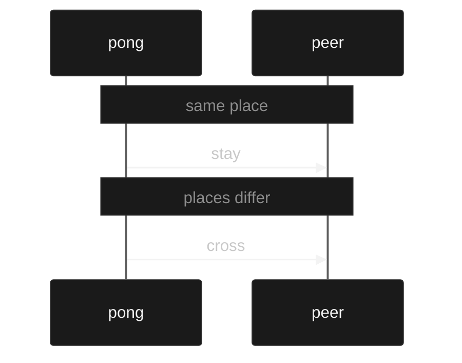

# Sessions

Muro supports binary session types. A session is a description of the messages two processes exchange and the order they exchange them. The two parties of the session are dual: every send on one is a receive on the other. The parties sit at places. When the places are the same the meeting stays. When the places differ the meeting crosses once. The meeting is the evidence that the two processes are those parties and that the seating matches the boundary. The OTP image is the only runtime that can produce the event of exchanging the payload and stopping `:normal` when the parties sit at different places. Other emitters do not implement the meeting.

`examples/meet.muro`
