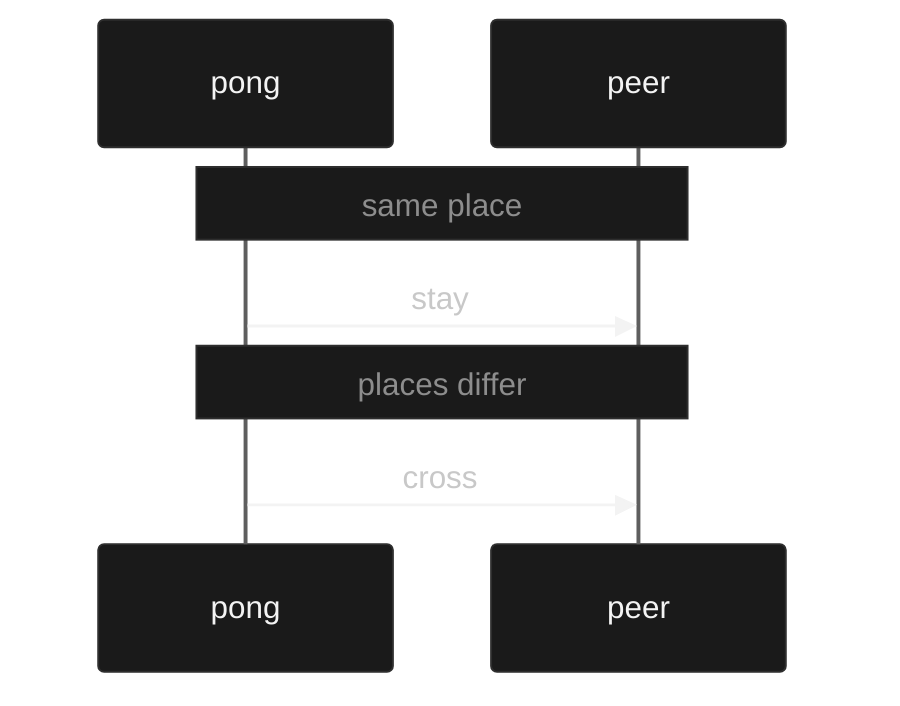

# Sessions

A session is a description of the messages two processes exchange and the order they exchange them. It is not the processes. It is the protocol.

You write the protocol once:

```muro
session ping := recv Nat (send Nat end)
```

This says: the process that holds this end receives a nat, then sends a nat, then ends. The other end is the dual:

```muro
session back := dual ping
```

`back` is `send Nat (recv Nat end)`. Every send on one is a receive on the other. That is duality.

A process is evidence that it follows one end of the protocol. You write it with `conform`:

```muro
conform pong : ping := get (k : Nat) (put 1 done)
```

`get` receives. The binder `(k : Nat)` names the value. `get Nat` receives a nat and does not name it. `put` sends. `done` ends. The process `pong` follows `ping`: it receives a nat, then sends the literal `1`.

The other process follows the dual:

```muro
conform peer : back := put 1 (get (m : Nat) done)
```

It sends `1`, then receives a nat.

The meeting is the check that these two processes are the two parties of one description:

```muro
meet wire : pong with peer
```

The meeting is evidence. It is not a run term. A run definition has no seat. The OTP image is the only runtime that can produce the event of exchanging the payload and stopping `:normal` when the parties sit at different places. Other emitters do not implement the meeting.

Places are where the parties sit. When the places are the same, the meeting stays. When the places differ, the meeting crosses once. The boundary is the seating. The payload stays on the session.



`examples/meet.muro`

## Value binding

Value binding is the ability to name what you received and send it later:

```muro
conform echo : ping := get (k : Nat) (put k done)
```

`k` is bound by the `get`. The `put` uses it. The innermost binding wins. The payload type is data, so the bound value can be sent more than once. The meeting requires that name to be bound at exactly the type the other process receives.

## Dependence

A continuation may mention a nat that was received, as the length of a vector. The length of the vector that will be sent is the nat that was received. The dual sends that nat and then receives a vector of that length. The meeting checks that the value the sender provides is the length the receiver's continuation expects.

```muro
session sized := recv (n : Nat) (send (Vec Nat n) end)
```

The OTP image sends two messages. The first is `{:muro, from, n}`. The second is `{:muro, from, vec}`, and the length of `vec` is `n`. A vector of another length stops the process with `{:shutdown, {:unexpected, value}}`.

## Evidence

A protocol may require that a sent nat is at most a bound. The bound is a numeral, or a nat bound earlier in the session. The sender owes that evidence. The receiver gets a nat.

```muro
session window := recv (w : Nat) (send (d : Nat) {d ≤ w} end)

session grant-end := dual window

conform window-server : window := get (w : Nat) (put w done)

conform window-client : grant-end := put 8 (get (d : Nat) done)

meet window-wire : window-server with window-client
```

The server receives a window and sends data within it. The process writes the nat alone. The checker finds the evidence, as `decide` in `Session.agda` does. A numeral within a numeral bound is evidence by `≤`. Zero is within any window. The window itself is within the window, when the process bound that name once. `get (w : Nat) (put 2 done)` has no evidence, because the window may be smaller. `put 8 (put 9 done)` at `send (w : Nat) (send (d : Nat) {d ≤ w} end)` is refused, because nine is not at most eight. `<=` is the same as `≤`.

The meeting compares the nats. The evidence is in each conformance, so a process without it is refused at its `conform`. The OTP image sends `{:muro, from, d}`. The evidence is not in the message.

## Index

A received bit selects one of two written continuations. The arm is the index. `b0` takes the first arm and `b1` takes the second. The sender writes the literal. A variable bit does not select an arm.

```muro
session route := recv (b : Bit) on (send Nat end) (recv Nat end)

session route-back := dual route

conform server : route := get (b : Bit) on (put 1 done) (get (n : Nat) done)

conform client : route-back := put b0 (get (m : Nat) done)

meet wire : server with client
```

`route` receives a bit. `b0` continues by sending a nat. `b1` continues by receiving a nat. `route-back` is the other end, so each arm is dualised and the index stays. `put b0` sends the literal and then receives the nat. `put b1 (put 0 done)` sends the bit and then the nat. The meeting checks that both sides take the same arm for the same bit.

The bound bit is a bit. A vector length may not mention it. Inside an arm the process can send it as an ordinary bit: `get (b : Bit) on (put b done) (put b done)` follows `recv (b : Bit) on (send Bit end) (send Bit end)`.

The OTP image sends `{:muro, from, :b0}` or `{:muro, from, :b1}`. The receiver's skeleton holds both arms. The message is the bit.

A nat does not choose the next action, so `recv (n : Nat) on end end` is refused. `get Bit on done done` is refused, because the bit is bound. `put b` against `send (c : Bit) on …` is refused: the sender writes `b0` or `b1`. A protocol whose arms are not dualised pointwise is not the other end. `choose` stays a label.

`examples/indexed.muro`

## Choice

A choice is an arm selection:

```muro
session choice := choose end (send Nat end)
session offered := dual choice
conform taker : choice := pick0 done
conform giver : offered := cover done (get Nat done)
meet arm : taker with giver
```

`pick0` takes the first arm. The other party covers both arms. The meeting checks that the chosen arm matches.

## Recursion

A protocol may repeat. `rec X. S` is that protocol again where `X` stands. The variable is a continuation, and the dot separates the name. It must sit under an action of its own `rec`. `send`, `recv`, a dependent action, an evidence action, an indexed bit, `choose`, and `branch` guard it. `rec` itself does not.

```muro
session loop := rec X. recv Nat (send Nat X)

session loop-back := dual loop

conform forever : loop := rec X. get (n : Nat) (put n X)

conform sender : loop-back := rec Y. put 1 (get (m : Nat) Y)
```

`loop` receives a nat and sends a nat, and then it is that protocol again. `loop-back` is `rec` of the dual, and the variable stays, so it sends a nat and receives a nat, forever. The process repeats with the same form. The name on the process is not the name on the protocol. `forever` and `sender` meet. A nat bound inside the loop is bound again on the next arrival.

A received bit can end the loop. `b0` takes the arm that repeats. `b1` takes the arm that ends.

```muro
session echo := rec X. recv (b : Bit) on (recv Nat (send Nat X)) end

session echo-back := dual echo

conform server : echo := rec X. get (b : Bit) on (get (n : Nat) (put n X)) done

conform client : echo-back := put b0 (put 1 (get (m : Nat) (put b1 done)))

meet wire : server with client
```

`client` echoes one nat and then sends `b1`. Both processes finish. The OTP image is a tail call: the server stores the body of `rec` and a jump runs that body again. It is not an unrolling.

`rec X. X` is not a protocol. `rec X. rec Y. X` is not one either: the second `rec` does not guard `X`. A name with no `rec` is not a protocol. `rec X. end` binds nothing and is `end`. `rec X. rec Y. send Nat X` is one loop, and both names are that loop. A jump does not finish, so `session %1` still refuses a process that can return to its `rec`. `rec X. done` does not jump, and it finishes.

`examples/recursive.muro`
