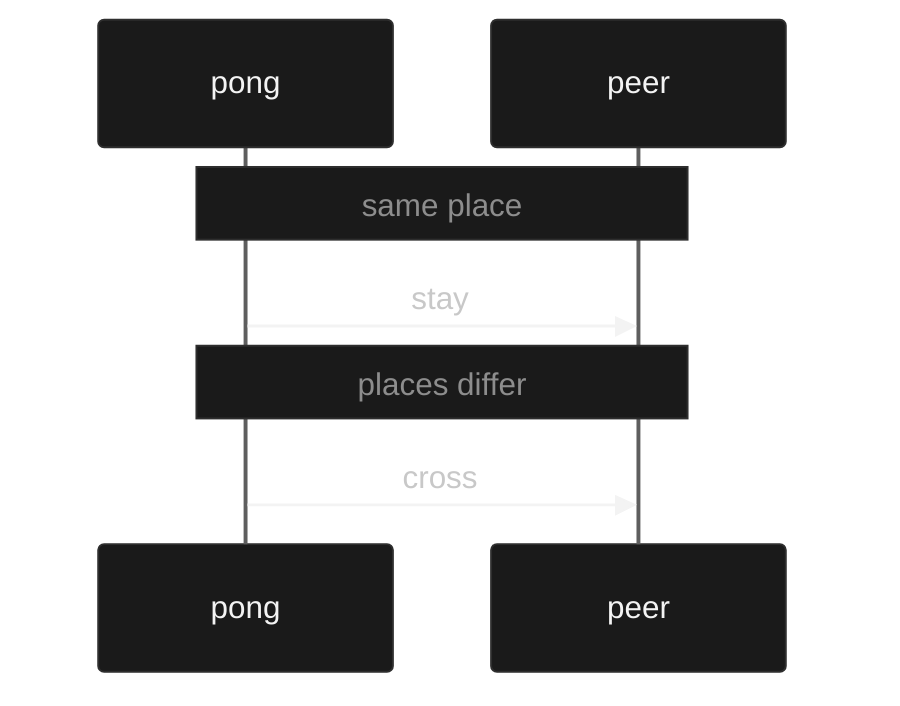

# Sessions

A session is a description of the messages two processes exchange and the order they exchange them. It is not the processes. It is the protocol.

You write the protocol once:

```muro
session ping := recv Nat (send Nat end)
```

This says: the process that holds this end receives a nat, then sends a nat, then ends. The other end is the dual:

```muro
session back := dual ping
```

`back` is `send Nat (recv Nat end)`. Every send on one is a receive on the other. That is duality.

A process is evidence that it follows one end of the protocol. You write it with `conform`:

```muro
conform pong : ping := get (k : Nat) (put 1 done)
```

`get` receives. The binder `(k : Nat)` names the value. `get Nat` receives a nat and does not name it. `put` sends. `done` ends. The process `pong` follows `ping`: it receives a nat, then sends the literal `1`.

The other process follows the dual:

```muro
conform peer : back := put 1 (get (m : Nat) done)
```

It sends `1`, then receives a nat.

The meeting is the check that these two processes are the two parties of one description:

```muro
meet wire : pong with peer
```

The meeting is evidence. It is not a run term. A run definition has no seat. The OTP image is the only runtime that can produce the event of exchanging the payload and stopping `:normal` when the parties sit at different places. Other emitters do not implement the meeting.

Places are where the parties sit. When the places are the same, the meeting stays. When the places differ, the meeting crosses once. The boundary is the seating. The payload stays on the session.



`examples/meet.muro`

## Value binding

Value binding is the ability to name what you received and send it later:

```muro
conform echo : ping := get (k : Nat) (put k done)
```

`k` is bound by the `get`. The `put` uses it. The innermost binding wins. The payload type is data, so the bound value can be sent more than once. The meeting requires that name to be bound at exactly the type the other process receives.

## Declared data

A data definition may be a payload when it has no indices and every constructor field is a payload: a nat, a bit, unit, a pair of those, a parameter, that same data type, or another such data type. The constructors are the ones that definition has. The other end receives the same type. The meeting checks that the sent value inhabits the type. `put (just 0)` does not inhabit `Bool`. `nothing` and `(just 0)` inhabit `Maybe Nat`. The OTP image carries the atom `true`, or the tagged tuple `{:just, 0}`.

```muro
data Bool : Type where
  true : Bool
  false : Bool

session flag := send Bool end

session flag-back := dual flag

conform up : flag := put true done

conform down : flag-back := get Bool done

meet flag-wire : up with down
```

## A computed put

A `put` may send the value an in-scope `run` definition computes from its arguments. The value that is sent is the value that function computes. The body is a first-order term: a variable, a literal, a constructor, a match on a constructor or a nat, or a call of a definition declared before it. Evaluation walks that prefix and the term, so a definition that calls itself, or a definition declared later, does not evaluate, including an arm the argument does not take. The meeting checks that the value inhabits the payload. The protocol stays spec. The process stays evidence. Nothing is added to the term language. The OTP image carries the value, and the definition is erased.

```muro
data Item : Type where
  self : Item
  other : Item

data Bool : Type where
  true : Bool
  false : Bool

data Maybe (A : Type) : Type where
  nothing : Maybe A
  just : A → Maybe A

def mark : run Π (f : Item) → Bool :=
  λ (f : Item) →
    match f motive (λ _ → Bool)
      | self => true
      | other => false

def effective : run Π (+ f : Item) → Maybe Bool :=
  λ (+ f : Item) →
    match f motive (λ _ → Maybe Bool)
      | self => just (mark f)
      | other => nothing

session answer := send (Maybe Bool) end

session answer-back := dual answer

conform reply : answer := put (effective self) done

conform hear : answer-back := get (Maybe Bool) done

meet reply-wire : reply with hear
```

`effective self` computes `just (mark self)`, and `mark self` is `true`, so the value sent is `just true`. `effective other` computes `nothing`. Both inhabit `Maybe Bool`, and they are different values. `put (bad self)` does not conform when `bad` computes a `Bool`. `put (size self)` sends `0`, which meets `send (d : Nat) {d ≤ 1}`. `put (size other)` sends `2` and does not. The same put may sit under `rec`: `rec X. put (effective self) X` follows `rec X. send (Maybe Bool) X`, and it meets the dual. A nullary `run` is the same form with no argument. `put (bump 0)` sends `1` when `bump` calls an earlier `run`. `put (plus 0 0)` is refused when `plus` calls itself.

## A value chooses the next action

The continuation of a `get` may match on the value that `get` just bound. The process has one arm per constructor, in declaration order. A bit is `b0`, then `b1`. The protocol after the `get` is one protocol. Each arm is a process that conforms to that protocol, and the processes may differ: `pick0 done` and `pick1 (put 0 done)` both follow `choose`, and `stop` and `done` both follow `end`. The received value chooses which of those processes runs. It does not choose a different protocol. Two protocols after a bit stay `recv (b : Bit) on S T`, and the sender writes the literal `b0` or `b1`. A variable bit and a computed bit do not select an `on` arm. The meeting checks that the chosen arm is the one the other party covers. The same form works for a declared data type.

```muro
session choice := recv Bit (choose end (send Nat end))

session offered := dual choice

conform taker : choice := get (b : Bit) (match b pick0 done pick1 (put 0 done))

conform giver : offered := put b0 (cover done (get Nat done))

meet arm : taker with giver
```

`b0` takes `pick0 done`. `b1` takes `pick1 (put 0 done)`. `get (b : Bool) (match b done done)` and `get (m : Maybe Nat) (match m done done)` cover `Bool` and `Maybe` the same way: `true` then `false`, `nothing` then `just`. A match that does not cover the received value is refused. `recv (b : Bool) on end end` is still refused: an indexed protocol is a bit, and the sender writes the literal.

`examples/computed.muro`

## Dependence

A continuation may mention a nat that was received, as the length of a vector. The length of the vector that will be sent is the nat that was received. The dual sends that nat and then receives a vector of that length. The meeting checks that the value the sender provides is the length the receiver's continuation expects.

```muro
session sized := recv (n : Nat) (send (Vec Nat n) end)
```

The OTP image sends two messages. The first is `{:muro, from, n}`. The second is `{:muro, from, vec}`, and the length of `vec` is `n`. A vector of another length stops the process with `{:shutdown, {:unexpected, value}}`.

## Evidence

A protocol may require that a sent nat is at most a bound. The bound is a numeral, or a nat bound earlier in the session. The sender owes that evidence. The receiver gets a nat.

```muro
session window := recv (w : Nat) (send (d : Nat) {d ≤ w} end)

session grant-end := dual window

conform window-server : window := get (w : Nat) (put w done)

conform window-client : grant-end := put 8 (get (d : Nat) done)

meet window-wire : window-server with window-client
```

The server receives a window and sends data within it. The process writes the nat alone. The checker finds the evidence, as `decide` in `Session.agda` does. A numeral within a numeral bound is evidence by `≤`. Zero is within any window. The window itself is within the window, when the process bound that name once. `get (w : Nat) (put 2 done)` has no evidence, because the window may be smaller. `put 8 (put 9 done)` at `send (w : Nat) (send (d : Nat) {d ≤ w} end)` is refused, because nine is not at most eight. `<=` is the same as `≤`.

The meeting compares the nats. The evidence is in each conformance, so a process without it is refused at its `conform`. The OTP image sends `{:muro, from, d}`. The evidence is not in the message.

## Index

A received bit selects one of two written continuations. The arm is the index. `b0` takes the first arm and `b1` takes the second. The sender writes the literal. A variable bit does not select an arm.

```muro
session route := recv (b : Bit) on (send Nat end) (recv Nat end)

session route-back := dual route

conform server : route := get (b : Bit) on (put 1 done) (get (n : Nat) done)

conform client : route-back := put b0 (get (m : Nat) done)

meet wire : server with client
```

`route` receives a bit. `b0` continues by sending a nat. `b1` continues by receiving a nat. `route-back` is the other end, so each arm is dualised and the index stays. `put b0` sends the literal and then receives the nat. `put b1 (put 0 done)` sends the bit and then the nat. The meeting checks that both sides take the same arm for the same bit.

The bound bit is a bit. A vector length may not mention it. Inside an arm the process can send it as an ordinary bit: `get (b : Bit) on (put b done) (put b done)` follows `recv (b : Bit) on (send Bit end) (send Bit end)`.

The OTP image sends `{:muro, from, :b0}` or `{:muro, from, :b1}`. The receiver's skeleton holds both arms. The message is the bit.

A nat does not choose the next action, so `recv (n : Nat) on end end` is refused. `get Bit on done done` is refused, because the bit is bound. `put b` against `send (c : Bit) on …` is refused: the sender writes `b0` or `b1`. A protocol whose arms are not dualised pointwise is not the other end. `choose` stays a label.

`examples/indexed.muro`

## Choice

A choice is an arm selection:

```muro
session choice := choose end (send Nat end)
session offered := dual choice
conform taker : choice := pick0 done
conform giver : offered := cover done (get Nat done)
meet arm : taker with giver
```

`pick0` takes the first arm. The other party covers both arms. The meeting checks that the chosen arm matches.

## Recursion

A protocol may repeat. `rec X. S` is that protocol again where `X` stands. The variable is a continuation, and the dot separates the name. It must sit under an action of its own `rec`. `send`, `recv`, a dependent action, an evidence action, an indexed bit, `choose`, and `branch` guard it. `rec` itself does not.

```muro
session loop := rec X. recv Nat (send Nat X)

session loop-back := dual loop

conform forever : loop := rec X. get (n : Nat) (put n X)

conform sender : loop-back := rec Y. put 1 (get (m : Nat) Y)
```

`loop` receives a nat and sends a nat, and then it is that protocol again. `loop-back` is `rec` of the dual, and the variable stays, so it sends a nat and receives a nat, forever. The process repeats with the same form. The name on the process is not the name on the protocol. `forever` and `sender` meet. A nat bound inside the loop is bound again on the next arrival.

A received bit can end the loop. `b0` takes the arm that repeats. `b1` takes the arm that ends.

```muro
session echo := rec X. recv (b : Bit) on (recv Nat (send Nat X)) end

session echo-back := dual echo

conform server : echo := rec X. get (b : Bit) on (get (n : Nat) (put n X)) done

conform client : echo-back := put b0 (put 1 (get (m : Nat) (put b1 done)))

meet wire : server with client
```

`client` echoes one nat and then sends `b1`. Both processes finish. The OTP image is a tail call: the server stores the body of `rec` and a jump runs that body again. It is not an unrolling.

`rec X. X` is not a protocol. `rec X. rec Y. X` is not one either: the second `rec` does not guard `X`. A name in a process with no `rec` is not a process. A name in a protocol is a session declared earlier, and that form is the next section. `rec X. end` binds nothing and is `end`. `rec X. rec Y. send Nat X` is one loop, and both names are that loop. A jump does not finish, so `session %1` still refuses a process that can return to its `rec`. `rec X. done` does not jump, and it finishes.

`examples/recursive.muro`

## A named continuation

A session declared earlier may be the continuation of another session. `req` is `send Nat (send Bit end)`. The name means that body. The same name may sit in an arm of `choose` or `branch`, after `on`, inside `rec`, and as the protocol of an endpoint. `dual req` is `req` with `dual` applied to that body. A process that conforms to `req` conforms to the body, and a meeting of the two ends checks as if the body had been written out.

```muro
session ack := send Bit end

session req := send Nat ack

session req-back := dual req

conform client : req := put 1 (put b0 done)

conform server : req-back := get Nat (get Bit done)

meet wire : client with server
```

`client` sends a nat and then a bit. `server` receives both. `wire` is that exchange, and the swapped meeting is the same pair. `examples/session-calls.muro` also writes `ack` in a `choose` arm, after `on`, and inside `rec`, and returns `req` from a linear endpoint.

## A parameterised session

A session may take parameters. A parameter is a nat, written before `:=`, and it may appear wherever a length or an evidence bound may appear. An argument is a numeral, a nat already in scope, or a `run` application that evaluates to a nat. `frames 3` is `send (Vec Nat 3) end`. `stream n` sends a nat at most `n` and continues as `stream (suc n)`. The self-call sits under `send`, so it is that protocol again, at the next nat. `dual (stream 0)` is the body of `stream` with `dual` applied at `0`. A meeting of the two ends checks as if that body had been written out, in either order.

```muro
session frames (k : Nat) := send (Vec Nat k) end

session stream (n : Nat) := send (d : Nat) {d ≤ n} (stream (suc n))

session stream0 := stream 0

session stream-back := dual stream0

conform up : stream0 := rec X. put 0 X

conform down : stream-back := rec Y. get (d : Nat) Y

meet stream-wire : up with down
```

`up` sends `0` on every turn. The bound is `0`, then `1`, then the next nat, so `0` stays inside it. `down` is the other end. `frames (bump 0)` is `frames 1` when `bump` computes `suc` of an earlier `run`. `put (bump 0)` sends that nat on `send Nat`. A call of the session itself with no action under it, a call of a session declared later, an unknown name, the wrong number of arguments, and an argument that does not evaluate to a nat are refused before a meeting. `examples/session-calls.muro` is the worked book.

## A linear endpoint

An endpoint binder is affine by default, so the endpoint is used at most once. `λ¹` binds a session endpoint linearly, and the checker requires that variable to be used once. `⊸` is the arrow that accepts or returns a linear endpoint. `dual` keeps the multiplicity and dualises the protocol. A meeting of two linear endpoints requires each one to be consumed once; abandoning either is refused. The function is evidence, so it is erased before emit. The protocol stays spec. The process stays evidence. The OTP image still carries the value. `examples/linear.muro` is the worked book.

```muro
session ping := recv Nat (send Nat end)

def forward : (s : ping) ⊸ ping := λ¹ (s : ping) → s
```

The protocol may repeat, and a payload may be a declared data type. `dual` keeps `rec` and the payload. The multiplicity is the endpoint's. A computed put consumes the endpoint once, and so does a match whose every arm does. One abandoned arm does not: the meeting reports `linear variable unused`.

```muro
session loop := rec X. recv Nat (send Nat X)

def echo : (s : loop) ⊸ loop := λ¹ (s : loop) → s

data Bool : Type where
  true : Bool
  false : Bool

session flag := send Bool end

def pass : (s : flag) ⊸ flag := λ¹ (s : flag) → s

session flags := rec X. send Bool X

def flags-pass : (s : flags) ⊸ flags := λ¹ (s : flags) → s
```
